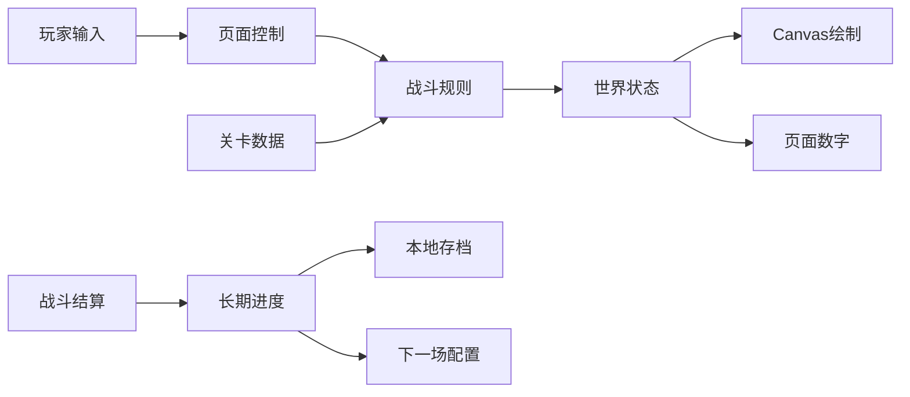

# 余烬王国 0.2.0：设计与实现

## 从想法到版本

先确定最小闭环：黄金 → 招募 → 战斗 → 结果 → 奖励。再把每个环节写成可验证的规则，最后让画面展示这些状态。绘制层只读取世界，按钮通过引擎改变世界，长期进度由独立模块管理。

## 实现顺序与验收

| 阶段 | 核心实现 | 验收 |
| --- | --- | --- |
| 纸面规划 | 经济、单位、胜负目标、屏幕草图 | 别人可以按规则重玩同一局 |
| 经济原型 | 矿工、背包、往返、入账 | 黄金只能在交金或指定奖励时增加 |
| 招募原型 | 扣款、顺序队列、退款、人口 | 买不起不扣钱，取消正确退款 |
| 战斗原型 | 位置、范围、冷却、伤害、死亡 | 一次命中只结算一次死亡与奖励 |
| 可玩一关 | 敌军经济、波次、指挥、基地 | 有可行胜利路线，也可以失败 |
| 长期系统 | 水晶、升级、星级、解锁 | 重玩奖励明确，刷新不丢进度 |
| 内容扩展 | 30 关、四种任务、六个区域 | 每关目标真实决定结算 |
| 装备补给 | 皮肤、库存、消费、效果 | 描述与规则相符，失败不扣库存 |
| 表现与体验 | 分层环境、动画、UI、触屏 | 手机可操作，无横向溢出 |
| 教学转化 | 小实验、课程、代码、打印材料 | 从空白文件到独立小作品可复现 |
| 发布 | 私有源码、标签、附件、私有站点 | 版本号一致，远端提交一致 |

## 战斗模型

世界宽度为 2700。所有速度使用每秒单位，模拟步长最大 0.1 秒，暂停时不推进任何时间。训练队列先扣款，队列中的单位也占人口。矿工走到矿点，开采完成后背负黄金返回，抵达基地才入账。

战士按水平距离寻找目标。近战直接命中，弓箭和法术先创建弹道，抵达后结算。法术和巨人有范围伤害；攻击冷却和位置规则决定命中频率。被击败的单位只产生一次死亡事件。

四种关卡通过同一引擎检查不同目标。基地被毁的失败优先级高于目标完成；限时关同一帧已经摧毁敌方雕像则获胜。护送矿车跟随前方护卫，遇到近处敌军就停下，避免自行冲出阵线。

## 外观与机制

美术采用原创 Canvas 与 SVG。火柴人由躯干、关节、武器和装备分层组成，行走、开采和攻击通过相位与冷却状态绘制。皮肤有可见几何差异：叶甲、冰冠、熔火裂纹、骨角、披风与雷纹；颜色以外还对应不同效果。

天气同样分开定义。雪景有雪粒和寒冷移速修正；沙暴与雾降低射程；火山中央区域每 8 秒造成双方伤害，并提前发亮提示。夜景改变视觉气氛，不隐含未说明的战斗加成。

## 关卡设计

每章五关：入门攻城、阵地防守、补给护送、限时突破、统领战。每关独立指定初始经济、敌方训练组合、波次时间、增援、环境和提示。波次表结束后仍有周期援军，避免失去压力；无尽模式则持续提高强度。

连续战役测试让同一个存档支付升级和皮肤，并在需要时购买补给。不同关卡使用不同招募顺序；测试中不修改血量、黄金或敌军数据。它证明当前标准规则存在完整通关路径，不替代真人试玩。后续应根据试玩的失败位置、说明理解程度与单局时长继续调整。

## 教学分层

12 次课程先用纸面资源和小数字，再逐渐接触按钮、绘制、移动和规则组合。每次明确孩子的设计权与家长的协助工作；以预测、尝试、观察、解释形成活动结构。规则可以在两次试验之间重新协商。

教学示例均为独立 HTML，避免安装成为第一道障碍。第 9 课开始的小作品将采矿简化为定时收入，让完整游戏仍容易阅读；第 6 课单独展示真实往返状态机。正式版源码提供进一步探索的对应关系。

## 发布范围

这不是原作官方客户端、原始关卡档案或授权素材包。当前没有联网对战、排行榜服务器、跨设备存档、真实支付、全部原作活动模式或逐帧动画复刻。0.2.0 的可验收范围以 README 功能表、30 关配置和测试为准。
