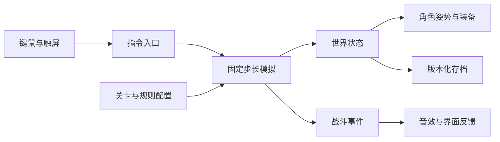

# 余烬王国 0.3.0：设计与实现

## 从玩家输入到战斗结果

这轮重构让指令、动作、命中与表现使用同一份规则。键鼠和触屏只产生指令，战斗引擎按固定的 1/60 秒步长处理；渲染层读取模拟状态，绘制身体、装备和特效。浏览器刷新率不决定攻击速度。

## 经济与军团

每方拥有四个有限矿脉，自动矿工寻找空闲位置，采掘进入矿袋，再回营交金。攻击敌方矿工会影响敌方正常征兵。脚本伏击独立记录为关卡事件，不伪装成采矿收入。

所有常规单位通过共享串行队列训练。下单扣款、队列占人口、取消退还实际支付金额，林叶装备的折扣也纳入退款。人口上限为 50，召唤小兵不计常规人口。

军团命令控制入堡、阵地防守和进攻。驻营部队退出战场并恢复生命，城堡弓手提供保护；巨人只能退到营地附近。盾矛兵投矛后用短剑，进入营地补给后恢复长矛。

## 兵种动作与命中

每个单位具有动作、前摇、释放点与恢复阶段。伤害在有效释放/命中时结算，不在点击或动画开始时提前扣血。移动输入在动作结束后继续生效。

箭矢和投矛具有真实位置、高度、速度与飞行轨迹，使用运动线段检测碰撞。目标移动可以使攻击落空，前排可以拦截箭矢。近战需要有效范围和方向。格挡、眩晕、减速、灼烧和吸血各自具有明确条件。

角色绘制读取同一动作数据。头、手、脚、武器、盾牌与装饰使用共同姿势锚点；七种装备外观跟随对应角色动作，矿袋也显示携金状态。战场纵深参与移动与命中，而非只改变绘制位置。

## 关卡与成长

30 关使用稳定的 classic-01 至 classic-30 标识。前 12 关按经典兵种学习顺序展开，接下来 6 关展示装备机制，最后 12 关综合检验策略。每关定义敌方经济、编队、进攻时机、撤退条件和有限增援。

金币只属于当前战斗。每个新关卡首次完成提供 2 升级点，兵器库中的矿镐、矿袋、武器、护甲和召唤上限独立升级。宝石购买按兵种解锁的皮肤和消耗法术。重复关卡不会重复授予升级点。

标准与亲子辅助分别记录关卡解锁和星级，共享资源与单次升级奖励。亲子辅助提供半速、暂停下令和提示，兵种练习不提供可转移的资源。

## 兼容性与可重复验证

新版存储键为 ember-kingdom-v3；旧键保留原样。迁移时复制旧成绩和战局到纪念册，返还旧升级与道具价值，皮肤所有权扩展到六种兵种。新主线从第一关开始，旧战斗快照不恢复。

战斗快照带有 schema、campaignId、levelId、rulesetVersion、随机种子和步长余数。恢复只接受兼容规则并保持暂停；版本或数据不兼容时回到新战斗入口。

规则测试使用小场景检验因果关系；连续战役通过真实指令和正常资源验证可通关；浏览器测试负责输入、布局和存档交互。三者不能互相替代。来源与标定边界见《规则对齐-0.3.0》，实际运行结果见《验证记录-0.3.0》。

## 教学对应

12 课保留从空白文件到小作品的完整路径。新增三个实验把正式系统拆成孩子能观察的小模型：黄金从矿山到矿袋再到仓库；动作从准备到命中再到恢复；同样的士兵因站位不同得到不同结果。每次让孩子先预测，再只改一个规则，最后解释观察到的差异。
